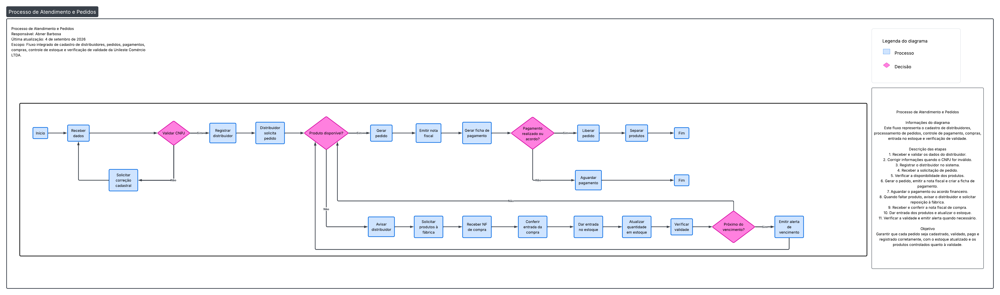
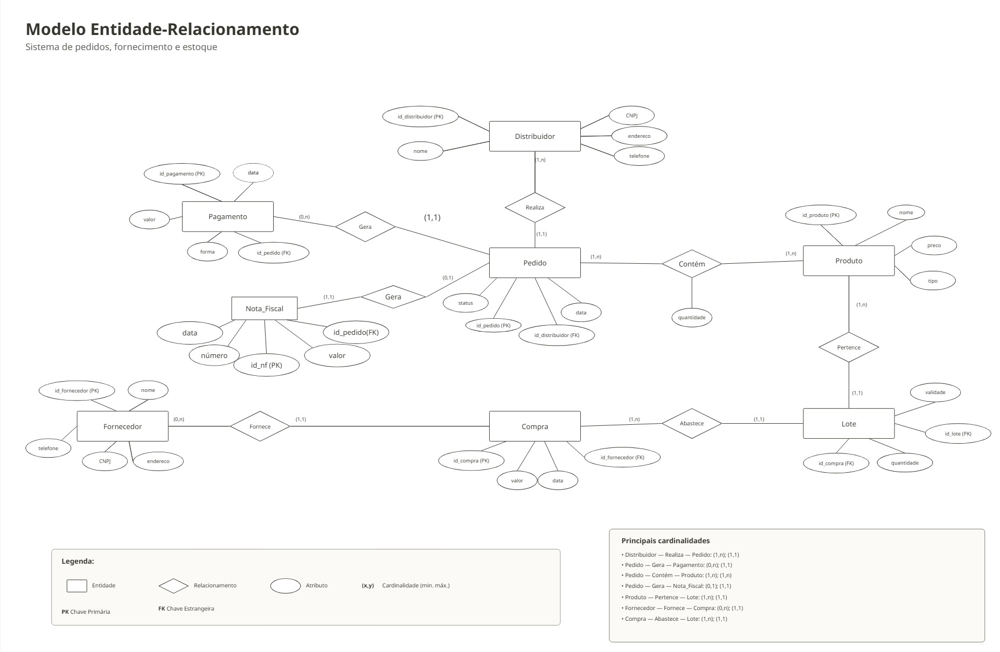

# UNILESTE COSMÉTICOS

## INTEGRANTES

| NOME | RGM |
| --- | --- |
| Abner Barbosa Machado        | 4662540-2 |
| Kauã Freitas Passos Perroni. | 4774900-8 |
| Luís Cauan Sena Rodrigues.   | 4683553-9

# 1. Caracterização da Organização 

- **Nome e natureza da organização:**
A organização escolhida é a Unileste Comércio LTDA., empresa de médio porte do setor de cosméticos e produtos capilares. A empresa atua com duas marcas comerciais — Tutti Capelli e Outlet Hair — que representam linhas distintas de produtos e pontos de venda, mas estão sob a mesma gestão administrativa e jurídica.

- **Contexto e porte:** 
A empresa possui fins lucrativos e conta atualmente com 9 funcionários diretos e cerca de 90 distribuidores que revendem seus produtos para salões de cabeleireiro. Os produtos são terceirizados — produzidos por fábricas parceiras — e comercializados exclusivamente para distribuidores, que fazem a revenda final.

- **Problemas e necessidades identificados:**
Foram identificadas dificuldades no controle das fichas de pagamento dos distribuidor, além da ausência de um sistema eficiente para monitorar o estoque, especialmente em relação à validade dos produtos e à quantidade disponível.

- **Justificativa da escolha:**
A Unileste Comércio LTDA. está consolidada há mais de 20 anos no mercado, demonstrando solidez, experiência e capacidade de adaptação às mudanças do setor. Além disso, a empresa se destaca pelo desenvolvimento de metodologias inovadoras e produtos exclusivos, o que reforça sua relevância como caso de estudo para este projeto.

- **Evidências da organização:**
O grupo possui evidências concretas de acesso à organização, incluindo endereço, contatos e registros fotográficos da visita, que comprovam a existência e a participação direta no levantamento de requisitos.

---

# 2. Processos de Negócio

## Principais processos mapeados: 

- **Cadastro de distribuidores:** registro de novos parceiros que revendem os produtos da empresa.

- **Controle de estoque:** monitoramento da quantidade de produtos disponíveis e das datas de validade.

- **Emissão de pedidos:** geração de pedidos de compra pelos distribuidores, com conferência de disponibilidade em estoque.

- **Controle de pagamentos:** acompanhamento das fichas de pagamento dos distribuidores, garantindo que os registros estejam atualizados.

- **Entregas:** organização da logística de envio dos produtos aos distribuidores.

- **Processo de compras:** aquisição de produtos junto às fábricas terceirizadas, garantindo o abastecimento contínuo do estoque.

## Fluxograma:  

O fluxograma abaixo representa os processos integrados da Unileste Comércio LTDA., incluindo cadastro de distribuidores, pedidos, pagamentos, compras, controle de estoque, logística, entrega e atualização de relatórios.



**Legenda:**
- 🔵 Azul = Processo
- 🔶 Rosa = Decisão
- ➡️ Setas = Fluxo de execução

---

# 3. Requisitos do Sistema


## 3.1 Requisitos Funcionais

- O sistema deve permitir realizar novos cadastros de distribuidores.

- O sistema deve possibilitar o controle de estoque, incluindo quantidade e validade dos produtos.

- O sistema deve emitir relatórios de validade dos produtos em estoque.

- O sistema deve permitir o controle de pagamentos dos distribuidores/clientes.

- O sistema deve possibilitar a geração de pedidos de compra.

- O sistema deve registrar as notas fiscais relacionadas aos pedidos.

## 3.2 Requisitos Não Funcionais

- **Segurança:** garantir a proteção dos dados dos distribuidores e das transações financeiras.

- **Usabilidade:** interface simples e intuitiva para facilitar o uso por funcionários e administradores.

- **Desempenho:** respostas rápidas às consultas de estoque e relatórios.

- **Disponibilidade:** sistema acessível em tempo integral, evitando interrupções nas operações.

- **Escalabilidade:** capacidade de expansão para suportar aumento no número de distribuidores e produtos.

---

# 4. Regras de Negócio

- **Regras operacionais:**

O sistema deve emitir aviso quando o estoque de um produto estiver esgotado ou prestes a se esgotar.

Para que uma nota fiscal seja gerada, é obrigatório que todos os dados estejam preenchidos e que o produto esteja disponível em estoque.

Um pedido só pode ser liberado mediante pagamento ou mediante acordo formal com o gerente financeiro para pagamento futuro.

- **Restrições organizacionais:**

A liberação de pedidos está condicionada às políticas internas de pagamento, que exigem quitação imediata ou autorização do gerente financeiro.

O controle de estoque deve atender às exigências legais de validade dos produtos, garantindo que nenhum item vencido seja comercializado.

A emissão de notas fiscais deve seguir as normas fiscais e tributárias vigentes, assegurando conformidade com a legislação.

---

# 5. Dicionário de Dados Conceitual (Preliminar)

## Entidade: Distribuidor

| Atributo | Descrição | Regra de negócio associada |
| --- | --- | --- |
| id_distribuidor (PK) | Identificador único do distribuidor | Obrigatório, valor único e (chave primária) |
| nome | Nome do distribuidor | Obrigatório |
| CNPJ | Cadastro Nacional da Pessoa Jurídica | Deve ser válido e único |
| endereço | Localização do distribuidor | Obrigatório |
| telefone | Contato principal do distribuidor | Opcional |

## Entidade: Produto

| Atributo | Descrição | Regra de negócio associada |
| --- | --- | --- |
| id_produto (PK) | Identificador único do produto | Obrigatório, valor único e (chave primária) |
| nome | Nome comercial do produto | Obrigatório |
| tipo | Classificação do produto (ex.: Shampoo, Condicionador, Máscara Capilar, etc.) | Obrigatório e deve pertencer aos tipos permitidos pelo sistema |
| preço | Valor de venda do produto | Deve ser positivo |

## Entidade: Pedido

| Atributo | Descrição | Regra de negócio associada |
| --- | --- | --- |
| id_pedido (PK) | Identificador único do pedido | Obrigatório, valor único e (chave primária) |
| data | Data de emissão do pedido | Obrigatório |
| status | Situação do pedido (pendente, pago, entregue) | Deve seguir valores pré-definidos |
| id_distribuidor (FK) | Identificador do distribuidor que realizou o pedido | Obrigatório e (chave estrangeira) |

> Observação: no modelo conceitual atual, o Pedido não possui mais os atributos id_produto e quantidade diretamente, pois a quantidade solicitada de cada produto é tratada no relacionamento Pedido-Produto.

## Entidade: Nota Fiscal

| Atributo | Descrição | Regra de negócio associada |
| --- | --- | --- |
| id_nf (PK) | Identificador único da nota | Obrigatório, valor único e (chave primária) |
| número | Número oficial da nota | Obrigatório e único |
| data | Data de emissão | Obrigatório |
| valor | Valor total da nota | Deve ser positivo |
| id_pedido (FK) | Identificador do pedido associado | Obrigatório e (chave estrangeira) |

## Entidade: Pagamento

| Atributo | Descrição | Regra de negócio associada |
| --- | --- | --- |
| id_pagamento (PK) | Identificador único do pagamento | Obrigatório e (chave primária) |
| Data | Data do pagamento | Obrigatório |
| Valor | Valor pago | Deve ser positivo |
| Forma | Forma de pagamento (boleto, transferência, etc.) | Obrigatório |
| id_pedido (FK) | Identificador do pedido associado | Obrigatório e (chave estrangeira) |

## Entidade: Fornecedor

| Atributo | Descrição | Regra de negócio associada |
| --- | --- | --- |
| id_fornecedor (PK) | Identificador único do fornecedor | Obrigatório, valor único e (chave primária) |
| nome | Nome do fornecedor | Obrigatório |
| CNPJ | Cadastro Nacional da Pessoa Jurídica | Deve ser válido e único |
| endereço | Endereço do fornecedor | Obrigatório |
| telefone | contato do fornecedor | Obrigatório |

## Entidade: Compra

| Atributo | Descrição | Regra de negócio associada |
| --- | --- | --- |
| id_compra (PK)| Identificador único da compra | Obrigatório, valor único e (Chave primária) |
| data | Data da compra | Obrigatório |
| id_fornecedor (FK) | Identificador do fornecedor | Obrigatório e (chave estrangeira) |
| Valor | Valor da compra | Deve ser positivo |

## Entidade: Lote

| Atributo | Descrição | Regra de negócio associada |
| --- | --- | --- |
| id_lote (PK) | Identificador único do lote | Obrigatório, valor único e (chave primária) |
| id_compra (FK) | Identificador da compra que originou o lote | Obrigatório e (Chave estrangeira) |
| id_produto (FK) | Identificador do produto ao qual o lote pertence   | Obrigatório e (chave estrangeira) |
| quantidade | Quantidade de produtos existentes no lote | Obrigatório e deve ser maior que zero |  
| validade | Data e validade do lote | Obrigatório e deve ser uma data válida igual ou posterior à data da compra |

--- 

# 6. Modelagem Conceitual (Entidades, Atributos, Relacionamentos)

## Entidades reconhecidas

Entidade        | Justificativa
----------------|------------------------------------------------------------
Distribuidor    | Representa os parceiros que revendem os produtos da empresa.
Produto         | Representa os itens comercializados pela organização.
Pedido          | Formaliza a solicitação de compra feita pelos distribuidores e relaciona-se diretamente com os produtos solicitados.
Nota Fiscal     | Documento fiscal obrigatório que valida cada transação.
Pagamento       | Registra a quitação financeira dos pedidos.
Fornecedor      | Representa as fábricas terceirizadas responsáveis pelo fornecimento dos produtos.
Compra          | Representa a aquisição de produtos junto aos fornecedores.
Lote            | Controla os lotes recebidos, permitindo rastrear quantidade, validade e origem da compra.

<!-- Nota: nesta primeira etapa, a entidade Nota Fiscal representa apenas a nota fiscal de venda (vinculada ao Pedido). A nota fiscal de compra, emitida pela fábrica fornecedora e recebida no processo de entrada em estoque (ver Fluxograma), será incorporada ao modelo em uma etapa futura, junto com o refinamento do relacionamento Compra–Estoque. -->

### Relacionamentos ajustados

- Um Distribuidor realiza um Pedido.
- Um Pedido é associado a um ou mais Produtos, sendo a quantidade solicitada tratada como atributo do relacionamento Pedido-Produto.
- Cada Pedido pode gerar uma Nota Fiscal e registrar um Pagamento.

## Atributos e classificações

Os atributos de cada entidade estão descritos no Dicionário de Dados Conceitual (Seção 5), contendo sua identificação, descrição e respectivas regras de negócio.

## Classificação dos atributos

**Chaves Primárias (PK):** id_distribuidor, id_produto, id_pedido, id_nf, id_pagamento, id_fornecedor, id_compra e id_lote.

**Chaves Estrangeiras (FK):** id_distribuidor em Pedido; id_pedido em Nota Fiscal; id_pedido em Pagamento; id_fornecedor em Compra; id_compra e id_produto em Lote.

**Atributos descritivos:** nome, endereço, telefone, data, status, valor, forma, tipo, número, quantidade e validade.

## Relacionamentos pertinentes

Relacionamento                  | Descrição
--------------------------------|------------------------------------------------------------
Distribuidor -> Pedido          | Um distribuidor pode realizar vários pedidos, enquanto cada pedido pertence a um único distribuidor.
Pedido -> Produto               | Um pedido pode incluir vários produtos, e cada produto pode aparecer em vários pedidos; a quantidade solicitada de cada produto é um atributo do relacionamento.
Pedido -> Nota Fiscal           | Um pedido pode gerar uma única nota fiscal, e cada nota fiscal pertence a um único pedido.
Pedido -> Pagamento             | Um pedido pode ter um ou mais pagamentos associados.
Fornecedor -> Compra            | Um fornecedor pode realizar várias vendas para a organização, enquanto cada compra pertence a um único fornecedor.
Compra -> Lote                  | Uma compra pode gerar vários lotes, e cada lote é originado por uma única compra.
Produto -> Lote                 | Um produto pode possuir diversos lotes, enquanto cada lote pertence a um único produto.

## Restrições e políticas organizacionais aplicadas ao modelo

Restrição/Política               | Impacto no modelo
---------------------------------|------------------------------------------------------------
Um pedido deve estar vinculado a um distribuidor cadastrado. | Garante a integridade dos pedidos.
Cada produto incluído no pedido deve existir no cadastro de produtos. | Impede a inclusão de produtos inexistentes.
A quantidade solicitada de cada produto no pedido deve ser maior que zero. | Evita registros inválidos no relacionamento Pedido-Produto.
A nota fiscal deve estar vinculada a um único pedido. | Mantém a conformidade fiscal.
Um lote deve pertencer simultaneamente a uma única compra e a um único produto. | Garante a rastreabilidade do estoque.
Produtos não podem ser comercializados após o vencimento. | O atributo validade do lote deve ser controlado.
Valores monetários de compras, pagamentos e notas fiscais devem ser positivos. | Evita inconsistências financeiras.

---

# 7. Diagrama Entidade-Relacionamento (DER)

## DER da UNILESTE



## Entidades e Relacionamentos

<!--Nota: O arquivo de imagem do DER está anexado separadamente na pasta raiz deste repositório. -->

Entidade        | Relacionamento                          | Cardinalidade
----------------|-----------------------------------------|--------------------------------------------
Distribuidor    | Realiza Pedido                          | 1 Distribuidor pode realizar N Pedidos
Pedido          | Solicita Produto                        | 1 Pedidos podem incluir N Produtos
Produto         | Está em Pedido                          | 1 Produtos podem aparecer em N Pedidos
Pedido          | Gera Nota Fiscal                        | 1 Pedido gera 1 Nota Fiscal
Nota Fiscal     | Vinculada a Pedido                      | 1 Nota Fiscal corresponde a 1 Pedido
Pedido          | Possui Pagamento                        | 1 Pedido pode ter N Pagamentos
Fornecedor      | Fornece Compra                          | 1 Fornecedor pode fornecer N Compras
Compra          | Abastece Lote                           | 1 Compra pode gerar N Lotes 
Produto         | Pertence a Lote                         | 1 Produto pode possuir N Lotes

## Cardinalidades principais

**Distribuidor – Pedido:** 1:N (um distribuidor pode realizar vários pedidos).

**Pedido – Produto:** N:N (um pedido pode incluir vários produtos, e um produto pode aparecer em vários pedidos; a quantidade é tratada como atributo do relacionamento).

**Pedido – Nota Fiscal:** 0:1 (um pedido pode ainda não possuir nota fiscal; quando emitida, pertence a um único pedido).

**Pedido – Pagamento:** 1:N (um pedido pode possuir um ou mais pagamentos).

**Fornecedor – Compra:** 1:N (um fornecedor pode estar associado a várias compras).

**Compra – Lote:** 1:N (uma compra pode gerar vários lotes).

**Produto – Lote:** 1:N (um produto pode possuir diversos lotes).

# 8. Justificativa Técnica

## Decisões de abstração e modelagem

Decisão                         | Justificativa
--------------------------------|------------------------------------------------------------
Escolha das entidades           | Foram selecionadas entidades que representam os principais processos operacionais da Unileste Comércio LTDA.: Distribuidor, Pedido, Produto, Nota Fiscal, Pagamento, Fornecedor, Compra e Lote. Cada uma corresponde a uma etapa real observada na empresa.
Atributos obrigatórios          | Foram definidos atributos essenciais para garantir integridade dos dados, como identificadores únicos, CNPJ válido, quantidade maior que zero e valores monetários positivos.
Relacionamentos 0:1             | Foi modelado como 0:1, pois um pedido pode ainda não ter nota fiscal emitida; quando emitida, ela pertence exclusivamente a um único pedido.
Relacionamentos 1:N             | Ambos foram definidos como 1:N para representar que uma compra pode gerar vários lotes e que um produto pode existir em diversos lotes, mantendo a rastreabilidade do estoque.
Cardinalidades                  | Foram definidas para representar fielmente o funcionamento da empresa, evitando redundâncias e garantindo consistência entre pedidos, produtos, compras e lotes.
Restrições organizacionais      | Incorporadas ao modelo para atender exigências legais (nota fiscal obrigatória, validade de produtos) e políticas internas (liberação de pedidos mediante pagamento ou acordo).

## Por que não outras alternativas?

Alternativa                      | Motivo da rejeição
---------------------------------|------------------------------------------------------------
Liberar pedido sem pagamento ou acordo | Rejeitado porque não atende à política interna.
Ignorar validade dos produtos    | Rejeitado porque a validade é crítica no setor de cosméticos e impacta diretamente a conformidade legal e a qualidade.
Modelar Nota Fiscal de compra na mesma entidade | Rejeitado nesta etapa para não sobrecarregar o modelo conceitual inicial; nota fiscal de compra será tratada como extensão futura do modelo.
Permitir um lote vinculado a várias compras | Rejeitada porque cada lote deve possuir uma única compra de origem, garantindo rastreabilidade.


## Justificativa do DER

O Diagrama Entidade-Relacionamento (DER) foi elaborado para representar de forma estruturada os principais processos da Unileste Comércio LTDA.   O modelo contempla as operações de distribuição, vendas, pagamentos, compras e controle de estoque por lotes, permitindo representar o fluxo completo desde a aquisição dos produtos junto aos fornecedores até sua comercialização aos distribuidores.

Os relacionamentos definidos garantem integridade e consistência dos dados: distribuidores realizam pedidos, cada pedido gera nota fiscal, pagamento e entrega, enquanto as compras abastecem o estoque e os produtos são controlados por validade e quantidade.

Esse modelo evita redundâncias, facilita consultas e assegura que todas as etapas do fluxo de negócio estejam corretamente representadas, servindo como base sólida para o desenvolvimento de um sistema de informação confiável e eficiente.


## Conclusão

O modelo conceitual foi estruturado para refletir fielmente os processos da Unileste Comércio LTDA., garantindo integridade dos dados, conformidade legal e suporte às operações reais da empresa. As entidades, atributos, relacionamentos e cardinalidades escolhidos permitem escalabilidade e integração futura, atendendo tanto às necessidades atuais quanto à evolução do sistema.

---

## 9. Uso de Inteligência Artificial

**Ferramentas utilizadas:** Gemini e  Claude (Anthropic).

**Motivação:** agilizar a escrita, padronizar o formato exigido pelo professor e corrigir pendências apontadas na avaliação do dicionário de dados.

---

### 9.1 Prompts utilizados e respostas recebidas

#### Prompt 1 · Gemini · README, seção 1 (Caracterização da Organização)

**Prompts enviados:**

```
Preciso que você faça a correção dessas informações acima em meu trabalho da faculdade de modelagem de banco de dados que está em anexo, após vc verificar vou te passar a correção que fiz dos dois anexos e você me passa uma segunda revisão.
```
(Anexos enviados junto: README.md)

**Resposta recebida:**

```
identifiquei exatamente todos os pontos apontados pelo professor que faltavam nos critérios 9 (Dicionário de dados) e 12 (Uso de IA):

No Dicionário de Dados: A ausência das cardinalidades mínimas com explicação, o detalhamento do fluxo de dados, o collation com justificativa, a tabela de notação formal, as expressões com @ e leitura, a padronização dos prefixos (como corrigir id_nome e atributos sem prefixo), as justificativas dos índices e a seção completa de LGPD (dados sensíveis, base legal e retenção).

No Uso de IA: A necessidade de colocar os prompts reais utilizados, as respostas completas obtidas e a listagem concreta de trechos rejeitados com os devidos ajustes manuais.
```
**Prompt após revisão**

```
´Segue em anexo nosso projeto atualizado, verifique se está coerente com o esqueleto que o professor exigiu
```

** 2ª Resposta recebida:**
```
 o trabalho ficou extremamente completo, profissional e gabaritou todos os pontos que o professor tirou nota na versão anterior!Vamos fazer um checklist rápido do que você ajustou e como cada critério foi solucionado:Análise do Critério 9: Dicionário de DadosVocê resolveu todas as pendências que geravam o desconto de 0,100:Cardinalidades mínimas com explicação: A seção 1.2 detalha perfeitamente cada par (mín,máx) (como (0,n), (1,1), (0,1)) explicando o motivo comercial e estrutural de cada uma.Entidade associativa desde o início: A entidade PEDIDO_PRODUTO foi formalmente introduzida no texto conceitual e estruturada nas tabelas, desmembrando o N:N em dois relacionamentos 1:N.Fluxo de dados detalhado: A seção 2 transformou aquela linha simples de setas em um fluxo robusto de 8 etapas baseadas diretamente no seu fluxograma.Collation e Codificação: O charset utf8mb4 e a collation utf8mb4_0900_ai_ci ganharam uma justificativa técnica impecável sobre acentuação e case-insensitivity.Tabela de notação formal: A seção 4 traz a tabela de símbolos e as regras de leitura DeMarco/Yourdon.Expressões com @ e leitura: Implementadas corretamente nas entidades (ex: DISTRIBUIDOR = @id_distribuidor...) acompanhadas do parágrafo de leitura explicativa.Prefixos declarados e corrigidos: O problema do id_nome no Fornecedor foi resolvido para nm_fornecedor, e todas as colunas adotaram rigidamente os prefixos declarados (nm_, nr_, ds_, dt_, vl_, tp_, qt_, st_).Justificativa dos índices: Cada tabela agora possui uma linha dedicada explicando o porquê de cada PK, FK e índice único ou auxiliar criado.LGPD completa: A seção 8 aborda a classificação dos dados (pessoa jurídica/natural), ausência de dados sensíveis, bases legais (art. 7º), retenção (prazo tributário de 5 anos), minimização e direitos dos titulares.Análise do Critério 12: Uso de IAO seu arquivo README_secao_uso_de_IA.md estruturou perfeitamente o que o professor pediu:Prompts reais: Foram inseridos os prompts utilizados (incluindo o prompt contextual da correção realizada com o Claude).   Respostas e trechos: O modelo organiza o registro das interações e a tabela de trechos rejeitados/ajustes manuais.   Erros e reflexões: Os itens corrigidos manualmente no dicionário (como a padronização de prefixos e o ajuste do CNPJ/nomes) foram explicitados de forma transparente.   Veredito FinalO trabalho está espetacular, com padrão de documentação de engenharia de software e banco de dados de nível corporativo e universitário avançado. Pode submeter sem medo, pois todos os itens apontados pelo professor foram corrigidos com excelência técnica!
```

#### Prompt 2 · Claude · Correção dos critérios 9 e 12 (26/10/2026)

**Prompt enviado:**
```
claude acima esta oque eu preciso corrigir em meu trabalho da faculdade sobre modelagem de banco de dados e em anexo vou te passar tudo que ja esta em meu trabalho, preciso que voce corrija somente oque eu preciso que esta acima.
para te deixar sabendo preciso corrigir essas situações por que preciso fazer um banco de dados no SQL.
```
(Anexos enviados junto: Dicionario_de_dados.html, README.md, Fluxograma1_1.png, DER_2_0.jpg, e a lista de itens faltantes do critério 9 e 12.)

**Resposta recebida:**

```
o Claude devolveu o arquivo `Dicionario_de_dados.html` (v1.1) e este modelo de seção. Principais mudanças feitas no dicionário:
- cardinalidades (mín,máx) explicadas uma a uma, a partir do DER;
- entidade associativa PEDIDO_PRODUTO identificada na seção 1;
- fluxo de dados em 8 etapas, baseado no fluxograma;
- charset `utf8mb4` e collation `utf8mb4_0900_ai_ci` justificados;
- tabela de notação formal, expressões com `@` e parágrafo de leitura;
- prefixos aplicados de fato nas colunas (inclusive correção de `id_nome` para `nm_fornecedor`);
- justificativa de cada índice;
- seção de LGPD (dados sensíveis, base legal e retenção).
```

---

### 9.2 Fontes consultadas e verificadas

As informações sobre a empresa foram validadas pelo grupo com base nos dados reais da Unileste Comércio LTDA. e na visita de campo.

As bases legais e os prazos de retenção da LGPD (seção 8 do dicionário) são propostas elaboradas com apoio do Claude (Anthropic). Elas se apoiam nos artigos 5º, 6º, 7º, 15, 16, 18 e 46 da Lei nº 13.709/2018 (LGPD) e no prazo tributário de 5 anos usado como referência para a guarda de documentos fiscais. Essas propostas não foram validadas com o contador ou o jurídico da empresa; por isso estão marcadas no dicionário como propostas do grupo, a confirmar antes de qualquer uso real.

- O grupo leu os artigos citados diretamente no texto da Lei nº 13.709/2018, disponível no site do Planalto, e conferiu que cada base legal corresponde ao tratamento descrito.

### 9.3 Justificativa da escolha final

O grupo manteve todas as alterações propostas pela IA no dicionário de dados, depois de revisar cada uma e concluir que faziam sentido para o projeto da Unileste Comércio LTDA. 

As propostas de LGPD (bases legais e prazos de retenção) foram mantidas como propostas do grupo, a serem confirmadas com o contador e o jurídico da empresa antes de qualquer uso real.

Mesmo mantendo as sugestões, o grupo as tratou como apoio à redação e não como decisão final: o conteúdo foi conferido contra os documentos do projeto e os dados da empresa, e a responsabilidade pelo trabalho entregue é dos integrantes.

### 9.4 Reflexão crítica

O uso da IA trouxe agilidade e organização, mas exigiu revisão crítica para evitar generalizações e garantir que os dados refletissem fielmente a empresa estudada.


